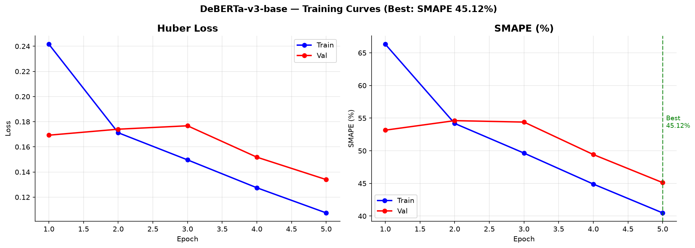
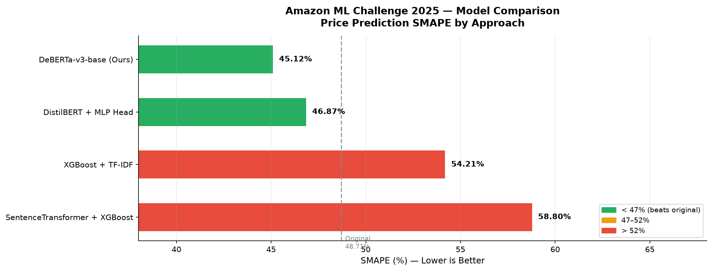

# Smart Product Price Predictor
### Amazon ML Challenge 2025 — Text-Based Price Regression

A text-only regression pipeline that predicts Amazon product prices from catalog descriptions using fine-tuned transformer models. No images, no external APIs — just structured text and a trained DeBERTa encoder.

**Best SMAPE: 45.12%** on validation set (75,000 products)

---

## How It Works

```
catalog_content (raw text)
        │
        ▼
┌───────────────────────┐
│   Regex Extractor v1  │  → item_name, item_value, item_unit, pack_count
│   Line-by-Line Parser │  → product_category, description (bullet points)
└───────────────────────┘
        │
        ▼
Structured Prompt:
"Category: [name] [SEP] description: [bullets] [SEP] Amount: [value] [unit]"
        │
        ▼
┌───────────────────────────────────────────┐
│         DeBERTa-v3-base Encoder           │
│         (184M params, fine-tuned)         │
│                                           │
│  tokens → 12 transformer layers →        │
│  mean pooling over all token embeddings   │
└───────────────────────────────────────────┘
        │  768-dim vector
        ▼
┌───────────────────────────────────────────┐
│            MLP Regression Head            │
│                                           │
│  LayerNorm → Linear(768→512) → GELU      │
│           → Linear(512→256) → GELU       │
│           → Linear(256→1)                │
└───────────────────────────────────────────┘
        │  scalar output (log1p space)
        ▼
   price = expm1(output)
```

**Key design choices:**
- `log1p` target transform stabilizes the right-skewed price distribution ($0.13 → $2796)
- Mean pooling over all tokens instead of [CLS] only — captures price signals spread across the full description
- LayerNorm before the MLP head — stabilizes encoder output scale
- Huber loss (delta=0.5) — robust to price outliers, switches from MSE to MAE for large errors
- Dual learning rates — encoder (3e-5) updated gently, MLP head (1e-3) trained aggressively from scratch

---

## Model Comparison

| Approach | SMAPE | GPU | Notes |
|---|---|---|---|
| **DeBERTa-v3-base + MLP (Ours)** | **45.12%** | Yes | Fine-tuned, mean pooling, v2 data |
| DistilBERT + MLP | 46.87% | Yes | Fine-tuned, 66M params, 5 epochs |
| XGBoost + TF-IDF | 54.21% | No | 50k bigram features, 500 trees |
| SentenceTransformer + XGBoost | 58.80% | No | Frozen all-MiniLM-L6-v2, 384-dim |

**Key finding:** Frozen embeddings + XGBoost underperform TF-IDF on product data because dense 384-dim vectors lose the specific keyword signals (brand names, exact quantities) that TF-IDF retains. Fine-tuning is what closes the gap — the encoder learns that "32 oz" at $4.89 implies a price-per-unit pattern.

---

## Project Structure

```
smart_price_predictor/
│
├── augmentation/
│   ├── regex_extractor.py        # v1: regex patterns for item/value/unit from text
│   └── regex_extractor_v2.py     # v2: line-by-line parser, extracts bullet points
│
├── training/
│   ├── dataset.py                # PyTorch Dataset, tokenization, log1p transform
│   ├── model.py                  # DeBERTa + MLP head, SMAPE metric, HuberLoss
│   └── trainer.py                # Training loop: mixed precision, checkpoint resume,
│                                 # thermal management, cosine LR schedule
│
├── inference/
│   └── predict.py                # Loads best_model.pt → generates submission.csv
│
├── experiments/
│   ├── 01_xgboost_tfidf_baseline.py       # TF-IDF + XGBoost baseline
│   ├── 02_sentence_embeddings_xgboost.py  # Frozen SentenceTransformer + XGBoost
│   ├── 03_distilbert_mlp.py               # Fine-tuned DistilBERT + MLP
│   └── 04_model_comparison.py             # Builds comparison table + chart
│
├── results/
│   ├── training_curves.png       # Loss and SMAPE per epoch
│   └── model_comparison.png      # Bar chart of all approaches
│
├── requirements.txt
└── README.md
```

---

## Reproduce Results

### 1. Setup
```bash
git clone https://github.com/AnshulDev-100/smart_price_predictor.git
cd smart_price_predictor

python -m venv venv
venv\Scripts\activate          # Windows
# source venv/bin/activate     # Mac/Linux

pip install --upgrade pip
pip install -r requirements.txt
pip install sentencepiece protobuf
```

> **GPU note:** Tested on NVIDIA RTX 5050 (8.5GB VRAM, CUDA 13.1). RTX 50-series (Blackwell) requires PyTorch nightly:
> ```bash
> pip uninstall torch torchvision torchaudio -y
> pip install --pre torch torchvision torchaudio --index-url https://download.pytorch.org/whl/nightly/cu128
> ```

### 2. Data Preparation
Place `train.csv` and `test.csv` in `data/`. Then run both extractors:
```bash
python augmentation/regex_extractor.py    # generates data/train_augmented.csv
python augmentation/regex_extractor_v2.py # generates data/train_augmented_v2.csv
```

**What each extractor does:**

`regex_extractor.py` uses regex patterns to pull quantity signals from embedded text:
```
"Heinz Ketchup 32 oz Pack of 6"  →  item_value=32.0, item_unit="oz", pack_count=6
```

`regex_extractor_v2.py` parses catalog_content line by line to extract explicit structured fields:
```
Value: 32        →  value=32.0
Unit: oz         →  unit="oz"
Bullet Point 1:  →  description (used in prompt)
```

### 3. Training
```bash
python training/trainer.py
```

Default config trains DeBERTa-v3-base for 10 epochs with checkpoint saving every epoch. Training auto-resumes from the latest checkpoint if interrupted — just run the same command again.

**If GPU runs out of memory**, reduce `batch_size` in `trainer.py` CONFIG and increase `grad_accum_steps` to keep the effective batch size at 16:
```python
"batch_size"       : 8,    # reduce this
"grad_accum_steps" : 2,    # increase this → effective batch = 8×2 = 16
```

### 4. Inference
```bash
python inference/predict.py
```
Loads `results/checkpoints/best_model.pt` and generates `results/submission.csv` with 75,000 predictions.

### 5. Run Experiments
```bash
python experiments/01_xgboost_tfidf_baseline.py
python experiments/02_sentence_embeddings_xgboost.py
python experiments/03_distilbert_mlp.py       # needs GPU, ~45 mins
python experiments/04_model_comparison.py      # builds table + chart
```

---

## Training Details

| Parameter | Value | Reason |
|---|---|---|
| Model | DeBERTa-v3-base | Best accuracy/VRAM trade-off |
| Max sequence length | 160 tokens | Covers 99.9% of prompts without truncation |
| Batch size | 16 | RTX 5050 limit (3.55 GB peak VRAM) |
| Encoder LR | 3e-5 | Small — preserves pretrained knowledge |
| Head LR | 1e-3 | Large — MLP head trains from scratch |
| Weight decay | 0.01 | L2 regularization via AdamW |
| Dropout | 0.2 | Applied in MLP head layers |
| Huber delta | 0.5 | Switches MSE→MAE at smaller errors |
| Warmup ratio | 0.1 | First 10% of steps ramp LR from 0 |
| LR schedule | Cosine decay | Smooth decay after warmup |
| Target transform | log1p / expm1 | Compresses $0.13–$2796 range |
| Pooling | Mean over all tokens | Better than [CLS] for regression |

---

## Known Issues and Fixes

**`sentencepiece` error on DeBERTa tokenizer load:**
```
ImportError: SentencePieceExtractor requires the SentencePiece library
```
Fix:
```bash
pip install sentencepiece protobuf
```

**CUDA not available on RTX 50-series (Blackwell):**
```
AssertionError: Torch not compiled with CUDA enabled
```
Fix: install PyTorch nightly with cu128 (stable builds don't support SM_120 architecture):
```bash
pip install --pre torch torchvision torchaudio --index-url https://download.pytorch.org/whl/nightly/cu128
```

**Architecture mismatch when resuming checkpoint:**
```
RuntimeError: Missing key(s) in state_dict: "regression_head.0.weight"
```
Fix: delete old checkpoints before changing model architecture:
```bash
del results\checkpoints\*    # Windows
rm results/checkpoints/*     # Mac/Linux
```

**PyArrow dtype error in experiments:**
```
TypeError: only integer scalar arrays can be converted to a scalar index
```
Fix: use `.tolist()` for text columns and `.to_numpy()` for numeric columns instead of `.values` when working with pandas DataFrames loaded with PyArrow backend.

**All predictions output $0.01 (clamped):**
Prompt mismatch between training and inference — model trained on v2 data but inference using v1 test file. Fix: ensure `test_path` in `predict.py` matches the data version used during training.

---

## Results

```
Validation set: 7,500 samples (10% split, random_state=42)
Training set  : 67,500 samples

Best model    : DeBERTa-v3-base, epoch 5
Val SMAPE     : 45.12%
Predictions   : min=$1.48  max=$135.68  mean=$20.83  median=$13.75
```



> Training stopped at epoch 5 (best val SMAPE: **45.12%**). Val loss begins rising after epoch 5 — `best_model.pt` is saved automatically at the lowest val SMAPE checkpoint.



---

## Tech Stack

- **PyTorch** — training loop, mixed precision (fp16), gradient clipping
- **HuggingFace Transformers** — DeBERTa-v3-base, DistilBERT, AutoTokenizer
- **XGBoost** — tree-based baseline experiments
- **SentenceTransformers** — frozen embedding baseline
- **scikit-learn** — TF-IDF vectorizer, train/val split
- **pandas / numpy** — data loading and preprocessing